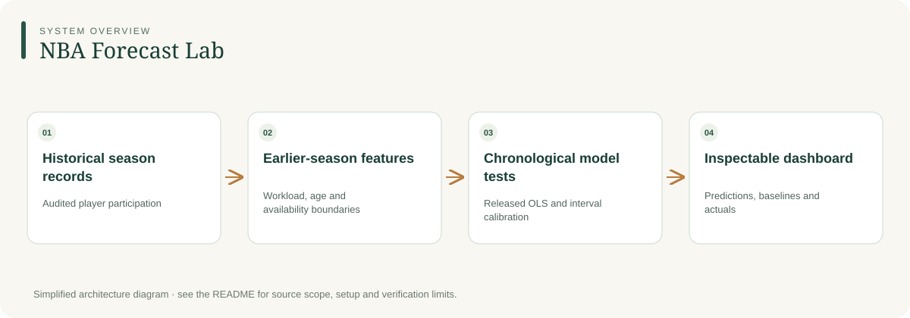
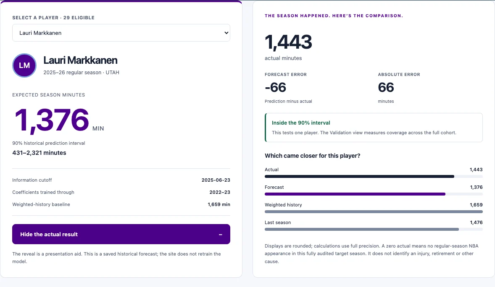

# NBA Forecast Lab

Inspect a historical player forecast before and after the result.

## The problem

Playing-time estimates need an eligible cohort, a known cutoff and a baseline. This project lets a reviewer reveal the historical outcome, compare errors and inspect the model evidence.

## How it works

The diagram summarizes the documented workflow; it is not a performance result or a generated application screenshot.

## A view of the project

Saved historical dashboard capture; use the live lab to reveal results and inspect the source periods.

## Run or inspect the work

[Open the historical Forecast Lab](https://bronsonhatch.com/nba-forecast-lab) · [Inspect the selected R calculation](examples/interval-calibration.R).

## Evidence and scope

The case study below reports the saved v0.3 playing-time results with their seasons, baselines, interval coverage and counterexamples. The November 2026 audit independently reconciled bundled forecast-export arithmetic and hashes; it did not refit the full model.

The results are retrospective tests, not forecasts proved to have been issued live before each season. Playing time is not player impact or deserved pay. This public repository contains selected code and evidence; complete source and original data/model caches are separate.

Detailed setup, original screenshots and project reference

# NBA Forecast Lab

Historical playing-time forecasting in R, with an interactive React dashboard for inspecting predictions and error.

I built this project to ask how many regular-season minutes and games a returning or recently active player might play next season. A visitor can select a player, reveal the historical result, compare baselines, and examine validation across seasons.

[Open the Forecast Lab](https://bronsonhatch.com/nba-forecast-lab)

## What I built

Audited season history → earlier-season features and cutoff checks → chronological model development → frozen regression settings → calibration/final tests → saved forecast exports → React dashboard.

The released v0.3 playing-time model uses direct OLS regression with nonnegative predictions. The eligible cohort includes players with an NBA appearance in the prior three seasons, including nonreturners; NBA rookies are outside scope. Historical team filters use recorded prior teams.

## Results with context

The saved release reports minutes RMSE of 432.37 versus 478.93 for weighted history in 2024–25, and 521.69 versus 579.44 in 2025–26. With equal weight for the two seasons, that is about 9.9% lower seasonal RMSE. This is retrospective evaluation, not a record of forecasts issued live before those seasons.

The model's minutes MAE is slightly worse than last-season carry-forward in 2024–25. Nominal 90% interval coverage is 91.69% and 87.68% in the two final tests; individual ranges remain wide. This estimates playing time, not player impact or deserved compensation.

## Inspect the implementation

[Selected R excerpt](examples/interval-calibration.R) shows the release's interval-score and calibration-quantile calculation. It is a small source excerpt, not a complete reproduction pipeline. The screenshot is a saved capture; the linked application displays saved analytical exports and does not train in the browser.

The full R analysis and dashboard source are maintained separately. Source data, serialized models, raw player records, and the existing full-project download are not duplicated into this curated showcase. The full R project's documented reproduction uses `renv::restore()`, source-download scripts, and `Rscript scripts/reproduce_release.R`; those commands require that complete project and do not run from this repository.

## Evidence and limitations

The saved v0.3 README records an isolated refit reproducing 4,746 playing-time and 124 salary calibration/test forecasts. This package was checked against those records; it does not claim a fresh model rerun. The separate salary model remains research and does not show reliable superiority to prior salary across both tests.

Public feed revisions, missing future injuries/roster decisions, repeated players, and common season shocks limit interpretation. The source project attributes SportsDataverse, hoopR, NBA Stats, and ESPN. No license to those providers' records, brands, or imagery is granted here.

[Use and attribution](USE-AND-ATTRIBUTION.md). Independent portfolio project; no NBA or team affiliation.

